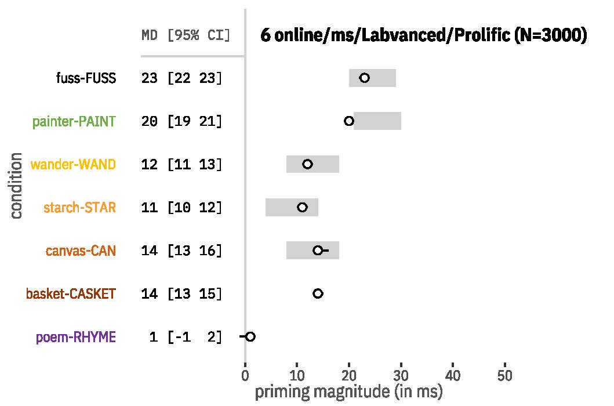

Cross-linguistic masked priming evidence shows that (a) bimorphemic (*boneless*) and (b) pseudo-affixed, monomorphemic words (*corner*) often trigger similar masked priming effects on their stems (*BONE* and *CORN*, respectively). In contrast, (c) monomorphemic words (e.g., *cashew*) trigger negligible effects on the embedded stem (*CASH*). The dissociation between (a, b) and (c) has been taken as evidence that lexical access goes through an obligatory decomposition procedure based on morpho-orthographic “islands of regularity”, i.e. the statistically regular letter sequences corresponding to the orthographic realizations of morphemes (Rastle et al., 2004). This procedure arguably occurs before accessing any lexical (morpho-syntactic, or semantic) information so that, at early stages, (b), but not (c), can be provisionally visually decomposed similarly to (a). Thus, this decomposition process is not an actual morphological or even linguistic process per se (despite often being described as “morphological decomposition”), but a visual process informed by morpho-orthographic statistical regularities. Recent findings, however, have challenged such a view, showing differential effects for (a) and (b), and similar effects for (a) and (c), or (b) and (c), thus suggesting early activation of the semantic distributed connections between the words and their embedded stems (e.g., Marelli & Baroni, 2015).

We conducted five different replications of the same English masked stem priming experiment both in-lab and online collected at different points in time (N=804). Five stem priming conditions were tested: (i) identity (*fuss-FUSS*), (ii) transparent morphological (*sharper-SHARP*), (iii) a pseudo-morphological (‘opaque’: *belly-BELL*); and two orthographic control conditions: (iv) non-syllabic (*bark-BAR*) and (v) syllabic (*cashew-CASH*). Items were controlled for orthographic length and word frequency. Semantic (cosine) similarity of prime and target pairs was calculated across five different distributional models (see Figure below). Trials consisted of a 33ms-long prime preceded by a 500ms-long forward mask, and followed by a target, on which participants performed a lexical decision task. After excluding subjects and items with high error rates, and trials with outlying prime durations or extreme RTs, we performed a varying-coefficient meta-analysis on the raw-data estimates across all five replications. To eliminate cross-replication sampling error, we then conducted a sixth preregistered confirmatory replication of the same experiment, with about four times larger sample size (N=2,868) and two more control conditions: (vi) orthographic neighbor (*basil-BASIN*) and (vii) associative semantic (*poem-RHYME*). After being pre-processed as in (A), the raw RT data was fitted with a Gamma distribution (identity link) in a GLMM, with condition, relatedness and their interaction as fixed factors, and subjects and items as random intercepts.

The results from the meta-analysis (A) and experiment (B) closely matched (see Figures below). Identity and morphological priming effects were equally at ceiling. Pseudo-morphological priming was significantly smaller than both, and overlapped with the non-syllabic and syllabic priming (in both A and B), as well as orthographic neighbor priming (in B). Semantic priming was around zero. Our results are incompatible with the proposal that lexical access includes a pre-lexical morpho-orthographic decomposition of the input, since pseudo-morphological priming (iii) patterned with purely orthographic priming (iv-vi). Morphological priming (ii) was instead indistinguishable from identity priming (i), possibly indicating that these priming effects obtain at the lexical, rather than at the prelexical level, even at such brief visual presentations (here, 33ms). At the same time, the null result for associative semantic priming (vii) precludes an early involvement of semantic processes (such as spreading activation) at such prime durations, and ultimately suggests an independent, linguistically sophisticated level of morphological analysis.

